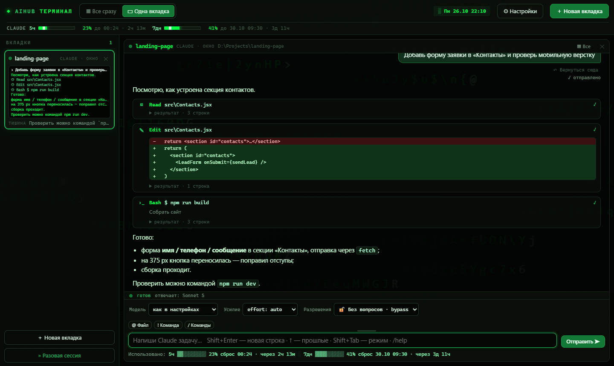

# AIHUB Терминал

Окно для Claude Code и Codex на Windows: проекты слева, переписка вместо
консоли, правки видны диффом, лимиты всегда сверху.

**Страница и скачивание:** https://alexdef228.github.io/aihub-terminal/

## Установка

1. Скачай [AIHUB-Terminal.zip](https://github.com/alexdef228/aihub-terminal/releases/latest/download/AIHUB-Terminal.zip) и распакуй его целиком.
2. Двойной щелчок по **«Установить.cmd»**. Он сам поставит недостающее
   (Python, Node.js, Claude Code), сделает ярлык и откроет окно.
3. В окне: **«＋ Новая вкладка» → «📁 Папки с проектами»**. Выбери папку,
   где лежат твои проекты.

Программа не подписана, поэтому Windows может предупредить: «Подробнее» →
«Выполнить в любом случае».

## Что в репозитории

| Путь | Что |
|---|---|
| `package/` | содержимое архива, кроме exe: установщик, `skin/` (список проектов, запуск Claude/Codex, статусная строка) |
| `build_package.py` | собрать `dist/AIHUB-Terminal-<версия>.zip` из собранного exe |
| `tools/shots.cjs` | снимки для странички + проверка экрана «Папки с проектами» (Playwright) |
| `tools/install_test.py` | установка, работа списка проектов и удаление в подставном профиле |
| `docs/` | страница на GitHub Pages |

Папки с проектами хранятся в `skin\settings.json` установленной копии
(`%LOCALAPPDATA%\Programs\AIHUB Terminal`) и меняются из окна.

## Лицензия

MIT
